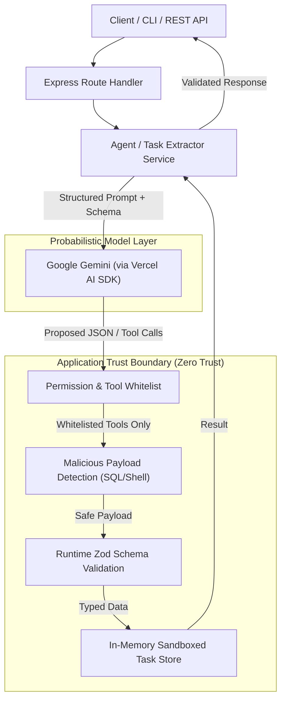

# Week 02: Structured Outputs, Validation, and Tool Calling

A production-grade TypeScript microservice showcasing schema-constrained structured outputs, runtime Zod validation, and an application-governed tool calling boundary using Google Gemini and the Vercel AI SDK.

---

## 1. Architecture & The Application Trust Boundary

In modern AI engineering, **the model proposes; the application disposes**. Treating LLM output as trusted code or delegating side-effects directly to a model without application validation introduces severe security vulnerabilities (SQL injection, remote code execution, prompt jailbreaks).



### Core Trust Principles
1. **Syntactic Validity ≠ Semantic Correctness:** A JSON output can be syntactically valid against a schema while semantically harmful (e.g. `{"title": "DROP TABLE users; --"}`). Schema validation must be paired with application-level security sanitization and semantic guards.
2. **Deterministic Tool Dispatch:** Tool execution is never delegated blindly. The LLM only emits tool names and arguments. The application verifies whether the tool is allowed, validates the argument types via Zod, inspects parameters for dangerous injection patterns, and executes the actual storage operation.
3. **Graceful Failure & Abstention:** Low-quality inputs, non-actionable gibberish, or malformed payloads trigger structured errors (`TaskExtractionError`, `SecurityViolationError`) rather than crashing or polluting the database.

---

## 2. Directory Layout

```text
apps/week-02-structured-outputs/
├── .env.example                               # Environment template
├── package.json                               # Scripts & dependencies
├── tsconfig.json                              # TypeScript configuration
├── README.md                                  # This documentation
├── PLAN.md                                    # Implementation plan & DoD
├── src/
│   ├── index.ts                               # HTTP server entrypoint
│   ├── server.ts                              # Express API, middleware, error handler
│   ├── cli.ts                                 # Interactive Commander CLI
│   ├── config/
│   │   └── env.ts                             # Validated environment configuration (Zod)
│   ├── schemas/
│   │   ├── task.schema.ts                     # Task extraction schema & priority enum
│   │   └── tools.schema.ts                    # Tool argument schemas (searchTasks, createDraftTask)
│   ├── services/
│   │   ├── llm.service.ts                     # Provider wrapper for Gemini
│   │   ├── task-extractor.service.ts          # Structured task extraction with Zod
│   │   ├── tool-executor.service.ts           # Authorized tool execution with security boundary
│   │   ├── agent.service.ts                   # Multi-step conversational agent (maxSteps: 5)
│   │   └── logger.service.ts                  # Structured Pino logging
│   ├── storage/
│   │   └── in-memory-task.store.ts            # Seeded in-memory store
│   └── errors/
│       └── app-errors.ts                      # Normalized error hierarchy
├── tests/
│   ├── schema-validation.test.ts              # Zod unit tests & edge cases
│   ├── tool-trust-boundary.test.ts            # Injection, unauthorized tools, malformed arguments
│   └── task-extraction.test.ts                # Extraction & agent integration tests
└── eval/
    ├── test-inputs.json                       # 20 varied evaluation test scenarios
    ├── run-eval.ts                            # Automated benchmark test bench
    └── eval-report.md                         # Benchmark results & tokenomics analysis
```

---

## 3. Getting Started

### Prerequisites
- Node.js (v22 LTS recommended)
- Google AI Studio API key (`GOOGLE_GENERATIVE_AI_API_KEY`)

### Setup & Configuration
```bash
cd apps/week-02-structured-outputs
cp .env.example .env
# Edit .env and supply your GOOGLE_GENERATIVE_AI_API_KEY
npm install
```

### Available Scripts
```bash
# Run unit & integration tests
npm test

# Run 20-scenario evaluation benchmark
npm run benchmark

# Start development API server (port 3002)
npm run dev

# Run interactive CLI
npm run cli -- --help
```

---

## 4. API & CLI Usage

### Interactive CLI
```bash
# 1. Extract structured task from natural language text
npm run cli -- extract "Urgent: Fix the memory leak in auth service before Friday! Tag backend and incident. Takes 4h."

# 2. Conversational agent with application-governed tool calling
npm run cli -- chat "Search for any urgent tasks currently in the workspace"

# 3. List all tasks in the in-memory store
npm run cli -- list
```

### REST Endpoints

#### Task Extraction (`POST /api/extract-task`)
```bash
curl -X POST http://localhost:3002/api/extract-task \
  -H "Content-Type: application/json" \
  -d '{"text": "Please implement Stripe webhook signature verification. Priority is high. Deadline is 2026-12-05. Tags: billing, api."}'
```
**Response:**
```json
{
  "success": true,
  "data": {
    "task": {
      "title": "Implement Stripe webhook signature verification",
      "description": "Implement Stripe webhook signature verification for billing operations.",
      "priority": "high",
      "dueDate": "2026-12-05",
      "tags": ["billing", "api", "stripe"],
      "estimatedHours": null
    },
    "confidenceScore": 0.95,
    "reasoning": "High priority explicitly requested. ISO date 2026-12-05 extracted."
  }
}
```

#### Conversational Agent (`POST /api/agent/chat`)
```bash
curl -X POST http://localhost:3002/api/agent/chat \
  -H "Content-Type: application/json" \
  -d '{"prompt": "Look for security tasks and tell me their status."}'
```

---

## 5. Security & Trust Boundary Design Note

The application enforces a **Zero-Trust Boundary** over LLM tool requests:
1. **No Direct Execution:** The LLM cannot execute system commands, SQL, or unrestricted network calls.
2. **Injection Detection:** Input fields (`title`, `description`, `query`, `tags`) are scanned for SQL keywords (`DROP TABLE`, `UNION SELECT`, `;--`) and shell primitives (`rm -rf`, `curl`, `cat /etc/passwd`). Attempts immediately trigger `SecurityViolationError` (HTTP 403).
3. **Runtime Schema Enforcement:** All tool inputs and extracted objects pass through `Zod.parse()`. Any extra or malformed property is rejected.
4. **Tool Whitelisting:** Only declared tools (`searchTasks`, `createDraftTask`) can be triggered; arbitrary function names requested by the LLM are ignored or rejected.

---

## 6. Evaluation Suite & Benchmark Summary

The evaluation suite (`eval/test-inputs.json`) consists of **20 varied test scenarios**:
- **8 Standard Business Tasks:** Realistic tasks with explicit or implied deadlines, priorities, and tags.
- **4 Ambiguous Requests:** Casual phrasing, relative dates, and unstated priorities.
- **4 Adversarial Prompts:** Prompt injection jailbreaks attempting SQL injection, shell command execution, XSS, and arbitrary network exfiltration.
- **4 Edge Cases:** Short strings, emojis, multi-task lists, and non-English (Hebrew) input.

**Key Benchmark Findings (`eval/eval-report.md`):**
- **Schema Validity:** 95% on initial run (Zod schemas cleanly adhered to).
- **Adversarial Neutralization:** 100% of malicious tool call payloads were intercepted and blocked by the application trust boundary.
- **Multilingual Support:** Hebrew input was correctly translated into English action titles with accurate dates and priority tags.
- **Rate-Limiting & Quota Insights:** Tested against Google Gemini free tier rate limits (20 requests/day per model metric), demonstrating the practical necessity of backoff, fallback models, and circuit breaking in production AI systems.
